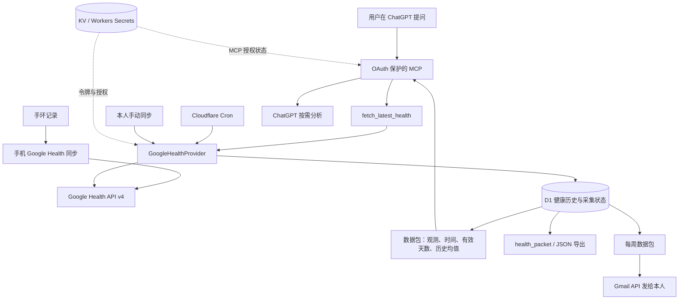

# fibitair 方案原理与架构

本文解释当前个人健康工作流如何运行，以及“可复现”具体覆盖到哪里。当前运行入口是 `src/workflow/worker.ts`；`src/index.ts`、`src/server.ts` 和参考项目中的 Claude 专用连接说明属于另一条历史路径。

## 1. 要解决的问题

目标是把手环已有的数据变成可持续保存、可追溯并可随时询问的个人健康资料：平时后台整理历史，提问时重新读取 Google Health，最后由 ChatGPT 结合可用背景给出建议。部署后无需每次手动下载、上传健康文件，也无需购买或设置 OpenAI API 密钥。

“即时读取”是服务器此刻向 Google Health 发起读取请求。手环到手机、手机到 Google 的同步仍由设备及手机应用负责，Worker 无法强制上传。即使读取成功，源端最新记录也可能落后于当前时间。

这是单用户自部署方案。公开的是源码、配置模板和说明；每位复现者使用自己的设备、Google 账户、Cloudflare 资源和授权，不接入原作者的健康数据库。

## 2. 三条链路

| 链路 | 触发方式 | 是否访问 Google Health | 结果 |
|---|---|---|---|
| 当场查询 | ChatGPT 调用 `fetch_latest_health(days=1..7)` | 是；采集最近 1–7 天，含今天 | 本次刷新状态、归档后的数据包，再交给 ChatGPT 分析 |
| 定时归档 | 每 6 小时；也可本人手动 `POST /sync` | 是 | 保存历史，覆盖最近窗口内迟到或修订的数据 |
| 历史读取和周包 | `health_packet`、`GET /export`、每周邮件 | 这些读取操作本身不刷新；周一 Cron 会先尝试采集 | 指定日期的归档；邮件是数据包，不是自动 AI 报告 |

周邮件不会自动唤起 ChatGPT。工作流没有每日 GPT 调度、自动日历读取、自动训练安排或故障即时推送。

## 3. 组件与责任

| 组件 | 负责什么 | 对应文件 |
|---|---|---|
| Cloudflare Worker + Hono | 路由、访问校验、定时入口 | `src/workflow/worker.ts` |
| 即时读取 | 申请采集锁、采集、返回本次成功状态与数据包 | `src/workflow/live.ts` |
| 归档核心 | 日期范围、逐指标采集、入库、有效天数和均值 | `src/workflow/core.ts` |
| Google 数据适配层 | OAuth、API 请求、字段映射、日期和分页 | `src/providers/google/` |
| MCP | 暴露 `fetch_latest_health`、`health_packet` 两个工具 | `src/workflow/mcp.ts` |
| MCP OAuth | 发现、动态客户端注册、授权、令牌与回跳限制 | `src/workflow/oauth.ts` |
| Gmail 周包 | 本人收件、前一完整周、去重和异常状态 | `src/workflow/gmail.ts` |
| 初始化工具 | 建资源、迁移、部署、发起 Google 本地授权、安装密钥 | `scripts/workflow-setup.ts` |
| 本地维护工具 | 状态、同步、导出、导入日程背景 | `scripts/health.ps1` |

### 数据存在哪里

| 位置 | 内容 | 公开仓库中是否包含 |
|---|---|---|
| D1 `observations` | 按日期和指标保存的观测数组、成功采集时间 | 否 |
| D1 `attempts` | 每个指标最近一次尝试时间及 `ok/empty/error` | 否 |
| D1 `context` | 本人录入的科研、课程、运动、恢复、备注 | 否；仓库只给虚构示例 |
| D1 `deliveries`、`locks`、`oauth_attempts` | 发信状态、采集锁、错误连接密钥次数 | 否 |
| `TOKENS` KV | Health access token、refresh token、到期时间 | 否 |
| `OAUTH_KV` KV | MCP OAuth 客户端、授权及令牌状态，由 OAuth Provider 管理 | 否 |
| `CACHE` KV | 沿用参考接口的缓存绑定；当前工作流直接调用 Provider，不用此缓存代替即时读取 | 否 |
| Workers Secrets | Google/Gmail 客户端密钥、Gmail 刷新令牌、本人邮箱、管理和只读令牌、MCP 连接密钥 | 否 |
| 本地 `secrets/`、`exports/`、OAuth JSON、实际 Wrangler 配置 | 部署者自己的密钥、导出、资源绑定 | 否；均应被 Git 忽略 |

归档以标准化观测为主；部分详细流保留 Google 来源字段或完整睡眠会话，但并不等同于保存每次完整 HTTP 原始响应。相同 `(day, stream)` 后续成功采集会替换旧数组，因此它是“每天每项最新成功快照”，并非每次读取的不可变审计日志。

## 4. 授权为何分两层

### Worker → Google

部署者在本机运行授权脚本，经 Google 同意后把凭据装入自己的 Cloudflare 实例。本地回调是 `http://127.0.0.1:8787/oauth/callback`，使用 state 和 PKCE；Google 的令牌不会提供给 ChatGPT。

Health 基础范围只读活动与健身、健康指标和睡眠。设备状态另需 `googlehealth.settings.readonly`，默认不开启。Google access token 临近到期会使用 KV 内的 refresh token 续期；刷新响应没给新 refresh token 时保留旧值。

Gmail 是独立授权，仅发送邮件，并查询邮箱身份确认收件人为本人。Worker 不申请 Gmail 收件箱读取权限。ChatGPT 如果额外使用自己的 Gmail 连接查近期背景，那是用户另行连接和允许的能力，不能算作本 Worker 自动读邮箱。

### ChatGPT → Worker

ChatGPT 连接本人实例的 `/live-mcp`，通过 Cloudflare OAuth Provider 完成授权。授权页输入本机 `secrets/MCP_OWNER_KEY.txt` 内的连接密钥；它用于确认实例所有者，不是 Google 授权密钥。

部署配置 `[vars]` 中的 `PUBLIC_ORIGIN` 必须填写自己的 HTTPS origin，例如 `https://YOUR-WORKER.YOUR-SUBDOMAIN.workers.dev`。服务仅用该配置确定 OAuth 资源声明及授权表单来源，不根据来访请求的 Host 自动决定。未配置或格式不合要求时 OAuth 返回 503；请求实际 origin 与配置不同、或授权表单来源不同，则返回 403。更换域名后需更新配置、重新部署并修改 ChatGPT 连接地址。

授权要求 PKCE S256、受支持的 ChatGPT 回调、同源表单提交和浏览器会话绑定。得到的客户端权限为 `health:read`，可申请 `offline_access` 续期。当前配置的访问令牌时效为 1 小时，刷新令牌时效和闲置时效均为 90 天；被撤销或会话失效时仍需重新连接。

另外保留本地管理用 Bearer 接口：`ADMIN_TOKEN` 可执行同步、安排导入等管理操作；`READ_TOKEN` 可查归档或调用 `/mcp`，不能写入安排或触发周邮件。MCP 的“只读”指不修改 Google 的健康记录；即时查询仍会更新部署者自己的 D1 归档。

## 5. 一次即时查询内部发生什么

1. 用户问最近健康、睡眠或恢复，ChatGPT 依据工具说明和项目指令选择 `fetch_latest_health`。
2. Worker 校验 MCP OAuth，再按北京时间确定今天；默认查询含今天在内的最近 7 天。
3. D1 申请 `sync` 锁，避免 Cron、手动同步和即时读取同时改写归档。锁租期为 15 分钟；未取得锁时返回 `busy`，不是“刷新成功”。
4. Provider 按数据流读取 Google Health；数据流依次处理，各自独立成功或失败。请求有超时；401 会使后续尝试刷新令牌，429 有有限重试。
5. 成功流按日期写入 D1，记录 `fetched_at`；无记录的日期保存空数组。失败流保留上次成功观测，只更新本次尝试为 `error`。
6. 生成数据包：本次日期范围、观测、相关安排、最近尝试状态、统计、前置 28 天基线、解释约束。
7. 返回 `requestedAt`、`refreshCompletedAt`、`refreshStatus`、`refreshSucceeded` 和 `packet`。全部流未出现 `error` 才会认为刷新成功；`empty` 仍可能是成功请求的结果。
8. ChatGPT 先说明读取时间、数据截至日期与缺失，再给健康总结和建议。模型仍可能漏调用工具或忽略约束，首次连接及换设备后要实际检查工具调用。

因此，“工具调用成功”“所有指标读取成功”“手环刚刚同步”“每项指标都完整”是四个不同的判断，不能互相替代。

## 6. 当前采集范围及解释

默认工作流定义 28 个数据流；设备状态为额外可选流。可用字段取决于设备、账户、权限和源端实际生成情况。

| 数据组 | 工作流流名 | 解释与边界 |
|---|---|---|
| 每日活动 | `steps`、`distance`、`calories`、`active_minutes`、`active_zone_minutes` | 距离单位为米；总消耗与活动消耗分别保存；活动区间分钟含强度加权，不等于实际运动分钟 |
| 睡眠 | `sleep`、`sleep_details` | 标准化分期与保留来源的完整会话；同日多次睡眠可存在；不强行把每条都标成主睡眠 |
| 每日健康指标 | `resting_heart_rate`、`hrv`、`respiratory_rate`、`spo2`、`skin_temperature` | HRV 为设备派生值；温度为夜间温度减基线，不是核心体温 |
| 心率与运动 | `heart_rate_5min`、`exercise` | 心率为 5 分钟聚合而非原始逐搏；运动保留 Google 的会话字段 |
| 明细 | `steps_hourly`、`hrv_samples`、`spo2_samples`、`respiratory_sleep`、`sedentary_periods` | 步数按小时；睡眠呼吸率是会话统计，不假设为连续曲线；缺口保留 |
| 心肺估计 | `vo2_daily`、`vo2_samples`、`vo2_run` | 三个来源均可能成功返回空；VO₂ max 是估计值 |
| 扩展活动 | `active_energy`、`heart_zone_time`、`heart_zone_calories`、`heart_zone_thresholds`、`activity_levels` | 保留 API 命名字段；活动强度只合并相邻、同级且时区偏移一致的区间，不跨缺口 |
| 温度详情 | `sleep_temperature_details` | 保留来源详情；字符串 `NaN` 表示未生成，不能变成有效数值 |
| 可选设备状态 | `device_status` | 需额外授权并显式开启；最近同步时间也不能证明每个指标完整 |

参考 Provider 还有个人资料、体重、饮食等读取接口，不代表它们都已接入当前 28 流归档或向 ChatGPT 暴露。以 `core.ts` 的 `streams` 和 MCP 的两个注册工具为准。

### 缺失、空与失败

| 状态 | 可以得出什么 | 不可以得出什么 |
|---|---|---|
| `ok` | 此流本次成功获得记录 | 区间每一天、每一分钟都完整 |
| `empty` / 某日 `data: []` | 读取成功但相应来源或日期无返回记录 | 0 步、0 小时睡眠、没有运动 |
| `error` | 本次该流失败，旧观测可能仍在 | 旧数据刚刚刷新成功 |
| `busy` | 另一个采集持有锁，当前返回归档 | 本次已完成新的读取 |

数据包内 `latestAttempts` 是各流最新尝试状态，并非每条历史观测的逐日完整性证明。分析时还要结合每行 `day`、`fetched_at` 与有效值。

血氧的 `lowerBoundPercentage` / `upperBoundPercentage` 在本方案中按置信区间边界解释。旧存档若有 `min/max`，同样不要当实测最低/最高读数。睡眠无分期时，映射层即使产生 `minutesAsleep: 0`，统计层仍将其视作未知。

## 7. 时间、历史与基线

Cloudflare Cron 使用 UTC。`15 */6 * * *` 对应北京时间每日 02:15、08:15、14:15、20:15；`0 1 * * MON` 对应每周一 09:00。周一那次计划还会先尝试采集最近 7 天，再生成上一完整自然周（周一到周日）的邮件。

每次定时采集覆盖最近 7 个自然日，目的是吸收同步延迟和来源修订，不是只追加今天。设备自然日沿用来源时区；5 分钟心率、按小时步数以 UTC+8 边界分组，时间戳可仍为 UTC。旅行或跨时区使用时，不能假设所有日汇总都与北京时间一致。

默认导出是最近 7 个已结束自然日；即时查询含今天。当天尚未结束，不能直接把当前步数或消耗与完整日均值相比。

基线是查询开始日前连续 28 个自然日，不含查询期。统计返回 `expectedDays`、`fetchedDays`、`validDays` 和 `mean`；仅对可解释的有效数值计算均值。睡眠按同日多次会话求和；其他每日流出现多个值而无法确定含义时不强行平均。

当前代码会给不足 28 天的有效样本算均值，调用者必须同时看 `validDays`，不能称之为完整 28 天基线。最初部署不会凭空拥有历史；可按最多 7 天一批手动回补，实际能回补多远取决于 Google 返回范围与分页预算。查询最多 90 天。

日级基线保留在数据包中；较早的密集明细不随每次数据包重复发送，但仍在 D1，可以单独查对应日期。数据库默认没有自动清理历史。

## 8. 结果怎样才算验收通过

需要分层验收，不能用一张“部署成功”截图覆盖整条链路：

| 层次 | 验收依据 |
|---|---|
| 能构建 | 本地类型检查、测试、Worker dry-run 通过 |
| 服务可达且隔离 | `/health` 为 200；未授权 `/export` 为 401；本人令牌可读 `/status` |
| 真数据采集 | 本人授权后采集，核对 API 状态、日期、有效样本并与手机对应字段对照 |
| 无人值守 | 访问令牌到期后的刷新成功；实际 Cron 连续运行后时间与观测更新 |
| 本人周包 | Gmail API 接受发送；随后本人确认收件，重复触发不会重复发送 |
| ChatGPT 连接 | OAuth 完成、工具列表可见、提问实际触发 `fetch_latest_health` |
| 日常使用 | 手机同账户可用，回答写明读取时间与数据截至日，缺失/失败提示准确 |

既有搭建会话与项目记录（2026-10-29）记载：Cloudflare 部署、真实 Health 读取、后台令牌刷新、Gmail API 发送，以及隔离浏览器中的 MCP OAuth 链路已验证；扩展的分时步数、HRV、血氧、睡眠呼吸率、久坐及后续七组补充数据曾返回记录；三个 VO₂ max 来源请求成功但为空。这些是既有验收记录，本次文档整理没有重新触发线上读取或发信，也不公开个人数据。

真实设备字段逐项对照、本人收件箱展示、ChatGPT 手机端体验、Google 控制台审核状态和多日 Cron 连续性需要部署者分别验证。设备 settings 范围不在默认验收内。详见[效果与验收记录](效果与验收记录.md)及[踩坑与排障](踩坑与排障.md)。

## 9. 复现的前提与边界

复现者需要自己的 Google Health 可用账户与数据、允许的 API 访问及 OAuth 范围、Cloudflare 账户，以及支持所需 MCP 功能的 ChatGPT 账户与界面。代码开源不代表平台会给每个账户同样的权限、设备字段或手机入口。没有自定义工具入口时，仍可先验证 Worker 与导出，再把本人导出文件用于分析。

个人实例只支持单一所有者；不是多租户产品。Google 发布状态不等于通过品牌或敏感权限验证；是否需要审核和额外条件以复现时控制台与官方说明为准。

公开发布不能包含实际 OAuth JSON、Google/Cloudflare 凭据、资源 ID、健康导出、本人日程、邮件正文或连接密钥。MIT 上游版权需保留。新增权限、自动调度或数据共享应先更新实现和说明，不能只靠项目指令宣称已经支持。

建议阅读顺序：本篇理解链路 → [从零搭建](从零搭建.md) → [踩坑与排障](踩坑与排障.md) → [日常使用指南](日常使用指南.md)。
